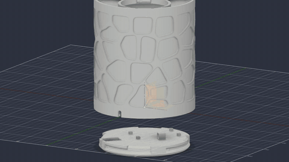
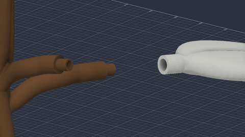
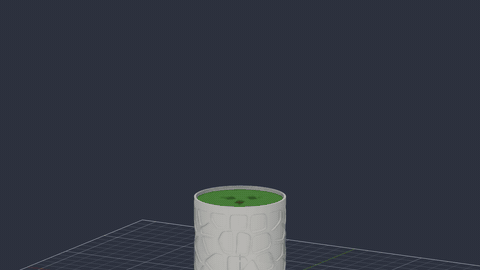
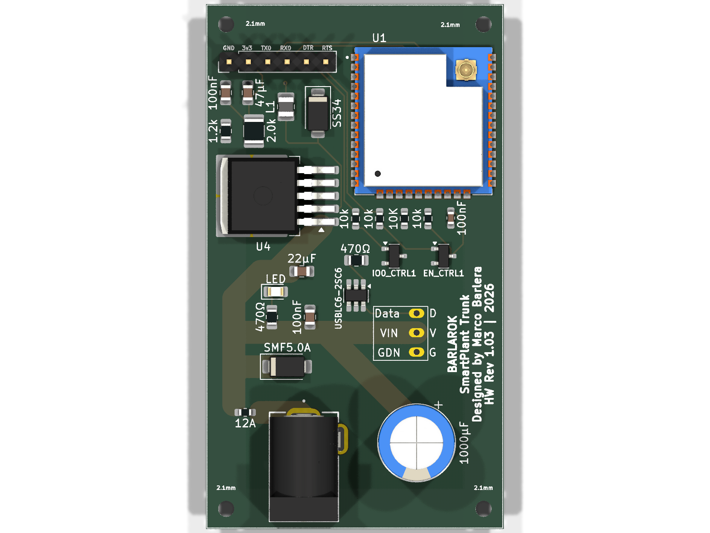
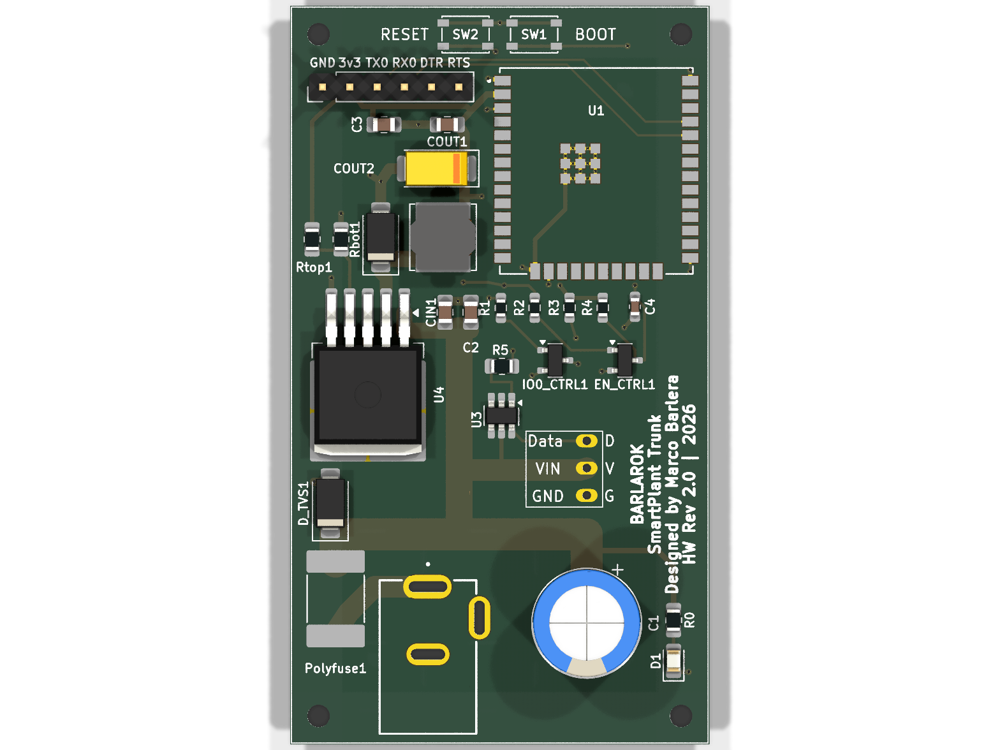
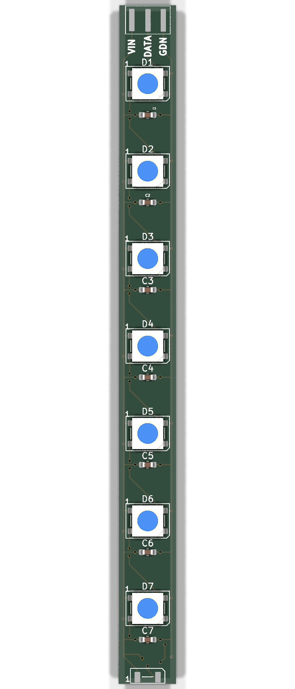
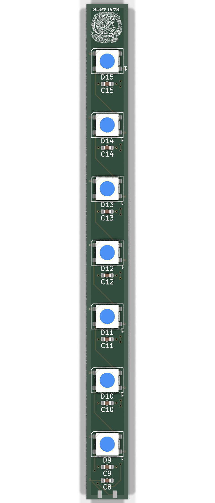

<div align="center">

# Yggdrasill

**Smart LED plant pot** — custom ESP32 PCB, addressable LEDs, WLED firmware, a modular 3D-printed vase, and a native iOS app with Apple's Liquid Glass design.

[](https://creativecommons.org/licenses/by-nc-sa/4.0/)
[](WLED-iOS/LICENSE)
[](docs/ios-app.md)
[](docs/hardware.md)



</div>

---

## What it is

A tree-shaped plant pot built from three independent pieces that come together into one object:

<table>
<tr>
<td width="33%" valign="top">

### Hardware
`PCB/`

ESP32 board driving WS2812B / SK6812 addressable LEDs, plus the leaf board that carries the LEDs. 5 KiCad projects: 4 base-board projects (dev-kit, bare-chip Rev 1.03, bare-chip Rev 2.0, USB-C) and the leaf (`Foglia`).

</td>
<td width="33%" valign="top">

### 3D print
`3D/`

Modular vase — base, lid, trunk, 3 branches, 9 leaves — joined with bayonet/snap-fit joints. FDM-printable in PETG or PLA. Prototype built in PLA on a Bambu Lab P2S; the supports inside the branches are hard to remove, see [3D/README.md](3D/README.md).

</td>
<td width="33%" valign="top">

### iOS app
`WLED-iOS/`

Liquid Glass redesign (iOS 26) of a WLED controller. mDNS discovery, WebSocket control.

</td>
</tr>
</table>

---

## Assembly preview

<table>
<tr>
<td align="center" width="50%"><b>Leaf insertion</b></td>
<td align="center" width="50%"><b>Branch assembly</b></td>
</tr>
<tr>
<td></td>
<td></td>
</tr>
</table>

---

## Status

**Working prototype built (Oct 2026):** vase, base, lid, 9 leaves and 3 branches printed in PLA on a Bambu Lab P2S, wired with Wago connectors, with 9 LED leaves; the plant lights up. The leaves will be reprinted to hide the visible layer lines.

| Component | Status |
|---|---|
| BaseChipOnly PCB | **Recommended.** Rev 1.03 (`PCB/BaseChipOnly/`) is fabricated and was brought up and tested; it works with workarounds. **Rev 2.0** (`PCB/BaseChipOnly_rev2/`) fixes every bring-up defect, new layout — verified by DRC/ERC and simulation only, **not yet fabricated or tested on hardware** |
| BaseDevKit PCB | Active |
| BaseUSB-C rev0.1 PCB | Early revision |
| Foglia PCB | Active (9 used in the prototype) |
| Modular vase (`3D/STL_stampa/`) | **Prototype built and working** (PLA, Bambu Lab P2S): vase, base, lid, 9 leaves and all 3 branches fit. Joints were tight at first and needed the mating surfaces smoothed. The fit of `TasselloFissaggioPCB.stl` with the PCB in the base is not yet verified. Tip: the supports inside the branches are hard to remove — a dissolvable/dedicated support filament might help (untested); the author cleaned them by hand with a screwdriver and wire. Print plate for the branches in `Rami.3mf`; details in [3D/README.md](3D/README.md) |
| iOS app (Liquid Glass) | In development |

---

## PCB renders

Board renders are generated from the KiCad files.

<table>
<tr>
<td align="center" width="50%"><b>Rev 1.03 &mdash; fabricated, tested</b></td>
<td align="center" width="50%"><b>Rev 2.0 &mdash; not yet fabricated</b></td>
</tr>
<tr>
<td></td>
<td></td>
</tr>
</table>

Bottom side: [Rev 1.03](PCB/BaseChipOnly/render/bottom.png) &middot; [Rev 2.0](PCB/BaseChipOnly_rev2/render/bottom.png). The renders also show the polyfuse and the two buttons (Rev 2.0) as simplified models, not the real components; regenerate them (and the leaf renders) with `python3 PCB/render/make_renders.py` — see [PCB/README.md](PCB/README.md#regenerating-the-renders).

<table align="center">
<tr>
<td align="center"><b>Leaf board (Foglia) &mdash; top</b></td>
<td align="center"><b>Leaf board (Foglia) &mdash; bottom</b></td>
</tr>
<tr>
<td align="center"></td>
<td align="center"></td>
</tr>
</table>

---

## Photos

Photos of the prototype, the electronics and the earlier versions are in the [docs/images/](docs/images/README.md) folder.

---

## What you need

| For | You need |
|---|---|
| The lamp | A 3D printer with about 256 mm of Z height (branches are up to 335 mm long and are printed lying down; prototype: Bambu Lab P2S, 0.4 mm nozzle, PLA) |
| The electronics | A fabricated `BaseChipOnly` PCB (Gerbers in `PCB/<variant>/Esportazione/`), 9 `Foglia` leaf boards, a USB-UART adapter for flashing WLED, a 5 V **4 A** power supply (see power notes in [docs/assembly.md](docs/assembly.md#power-requirements)) |
| Wiring | Thin, long wires and Wago-style splicing connectors (see [docs/3d-printing.md](docs/3d-printing.md#assembly-notes)) |
| Assembly tips | Solder paste stencils for the SMD boards (the leaf board is needed in 9 copies), see [docs/hardware.md](docs/hardware.md#assembly-tips-solder-paste-stencils) |
| PCB editing | **KiCad 9** (the project files are saved with KiCad 9 and do not open in KiCad 8) |
| The app | **Xcode 26** to build (the project is saved with Xcode 26.2); deployment target 16.0 as set in the Xcode project; the Liquid Glass design targets iOS 26 |

## How to build it

1. **Print** the parts from `3D/STL_stampa/` (PLA or PETG, 0.2 mm layers). Orientation, branch plate (`Rami.3mf`), support removal and joint clearances: [docs/3d-printing.md](docs/3d-printing.md) and [3D/README.md](3D/README.md).
2. **Fabricate the PCBs.** Gerbers are in `PCB/<variant>/Esportazione/` (Rev 2.0: `PCB/BaseChipOnly_rev2/Esportazione-2026-09-30/`); upload them to JLCPCB or PCBWay. Variants, BOM and fabrication notes: [docs/hardware.md](docs/hardware.md). The 3D base is designed for `BaseChipOnly` only.
3. **Flash WLED** on the ESP32 and **assemble** the lamp (wiring, base, trunk, branches, leaves, lid): follow [docs/assembly.md](docs/assembly.md) (work in progress). Board details and first power-up: [docs/base-chiponly-pcb.md](docs/base-chiponly-pcb.md).
4. **Control it** from the iOS app below, or from any WLED client.

### iOS app

Build with **Xcode 26** (the project is saved with Xcode 26.2). The app's deployment target is iOS 16.0 as set in the Xcode project; the Liquid Glass styling is the iOS 26 design language.

```bash
git clone --recurse-submodules https://github.com/ZonatedCord/Yggdrasill
open WLED-iOS/wled.xcodeproj
```

> `WLED-iOS/` is a git submodule pointing to the `liquid-glass-redesign` branch of [ZonatedCord/WLED-iOS](https://github.com/ZonatedCord/WLED-iOS) — a fork of [Moustachauve/WLED-iOS](https://github.com/Moustachauve/WLED-iOS) restyled with Apple's Liquid Glass (iOS 26). Already cloned without `--recurse-submodules`? Run `git submodule update --init`. More: [docs/ios-app.md](docs/ios-app.md).

---

## Repository structure

```
Yggdrasill/
├── PCB/               KiCad projects — BaseDevKit, BaseChipOnly (Rev 1.03), BaseChipOnly_rev2 (Rev 2.0), BaseUSB-C_rev0.1, Foglia + footprint library (Impronte/) + render/ (make_renders.py)
├── 3D/                Modular vase — Vaso/ (STEP sources + animations), STL_stampa/ (print-ready STLs + Rami.3mf)
├── WLED-iOS/          iOS app (Liquid Glass, GPL v3) — git submodule → ZonatedCord/WLED-iOS @ liquid-glass-redesign
├── docs/              Hardware, iOS, 3D printing, and assembly documentation
│   └── hardware-reviews/  PCB analysis notes (review + bring-up fixes)
├── LICENSE            CC BY-NC-SA 4.0 (hardware + 3D)
├── LICENSE-NOTICES.md Dual-license clarification
├── CHANGELOG.md
└── CONTRIBUTING.md
```

---

## Documentation

- [Hardware variants & BOM](docs/hardware.md)
- [iOS app architecture & Liquid Glass](docs/ios-app.md)
- [3D printing guide](docs/3d-printing.md) · [3D parts and wiring tips](3D/README.md)
- [Assembly guide](docs/assembly.md)
- [PCB variants and render script](PCB/README.md)
- [BaseChipOnly — how the board works](docs/base-chiponly-pcb.md) · [Rev 2.0: tests and changes](PCB/BaseChipOnly_rev2/README.md)
- [BaseChipOnly hardware review](docs/hardware-reviews/base-chiponly-review.md) · [bring-up defects & fixes](docs/hardware-reviews/base-chiponly-fixes.md)
- [Changelog](CHANGELOG.md) · [Contributing](CONTRIBUTING.md)

---

## License

**Hardware & 3D models** (`PCB/`, `3D/`, `docs/`) — Creative Commons Attribution-NonCommercial-ShareAlike 4.0 International, Copyright (c) 2025 Marco Barlera. Free for personal and maker use; commercial use requires explicit written permission.
See [LICENSE](LICENSE) · [creativecommons.org/licenses/by-nc-sa/4.0](https://creativecommons.org/licenses/by-nc-sa/4.0/)

**iOS app** (`WLED-iOS/`) — GNU General Public License v3.0, inherited from [Moustachauve/WLED-iOS](https://github.com/Moustachauve/WLED-iOS). Copyleft; cannot be changed.
See [WLED-iOS/LICENSE](WLED-iOS/LICENSE)

Full dual-license details: [LICENSE-NOTICES.md](LICENSE-NOTICES.md)

---

<div align="center">

**Marco Barlera** — [marcobarlera.com](https://marcobarlera.com) — barleramarco05@gmail.com

Commercial licensing inquiries: contact via email.

</div>
