# Photos

Photos of the Yggdrasill prototype, its electronics and earlier versions.

### The prototype

<table align="center">
<tr>
<td align="center" valign="top">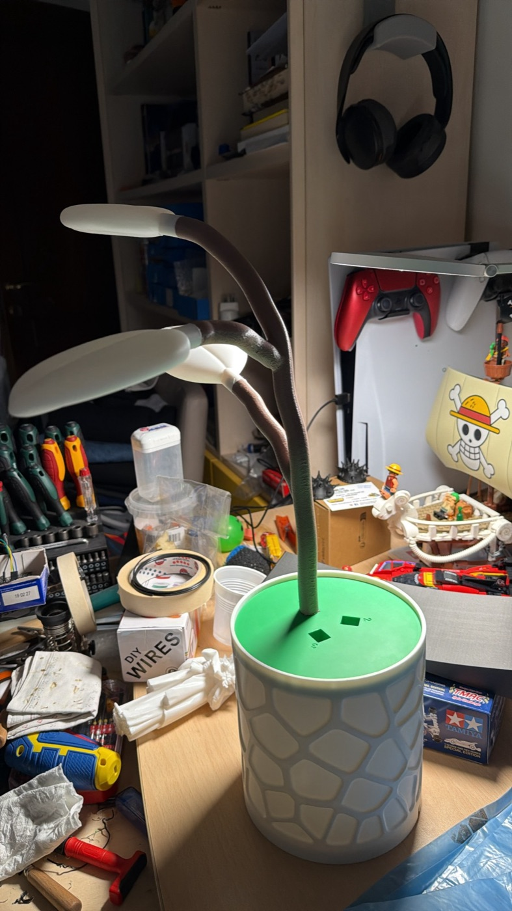 The prototype: white 3D-printed vase, green lid, three painted branches with leaves</td>
<td align="center" valign="top">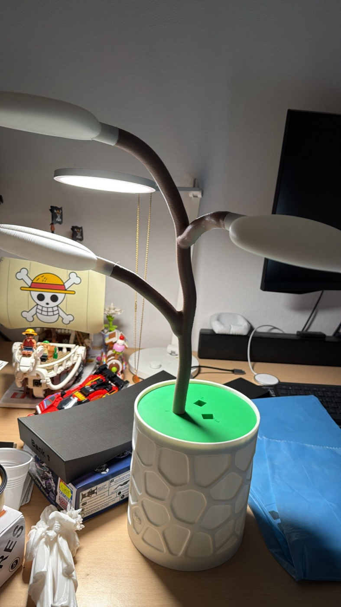 The prototype from another angle</td>
<td align="center" valign="top">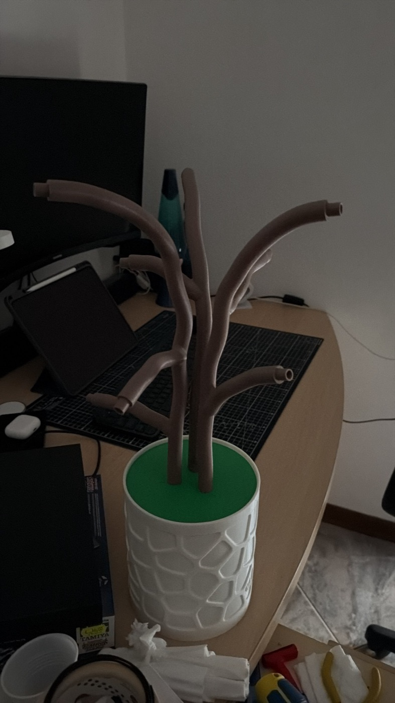 The three painted branches in the lid, before the leaves are fitted</td>
</tr>
<tr>
<td align="center" valign="top">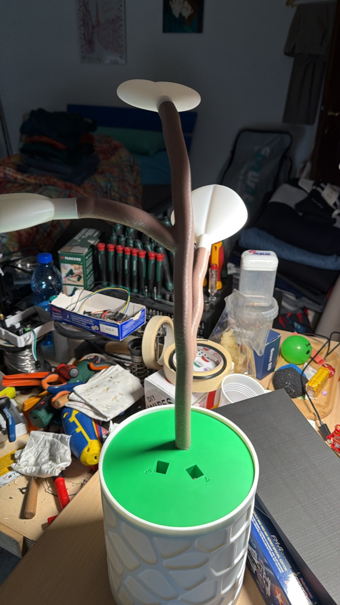 Assembling branches and leaves on the lid</td>
<td align="center" valign="top">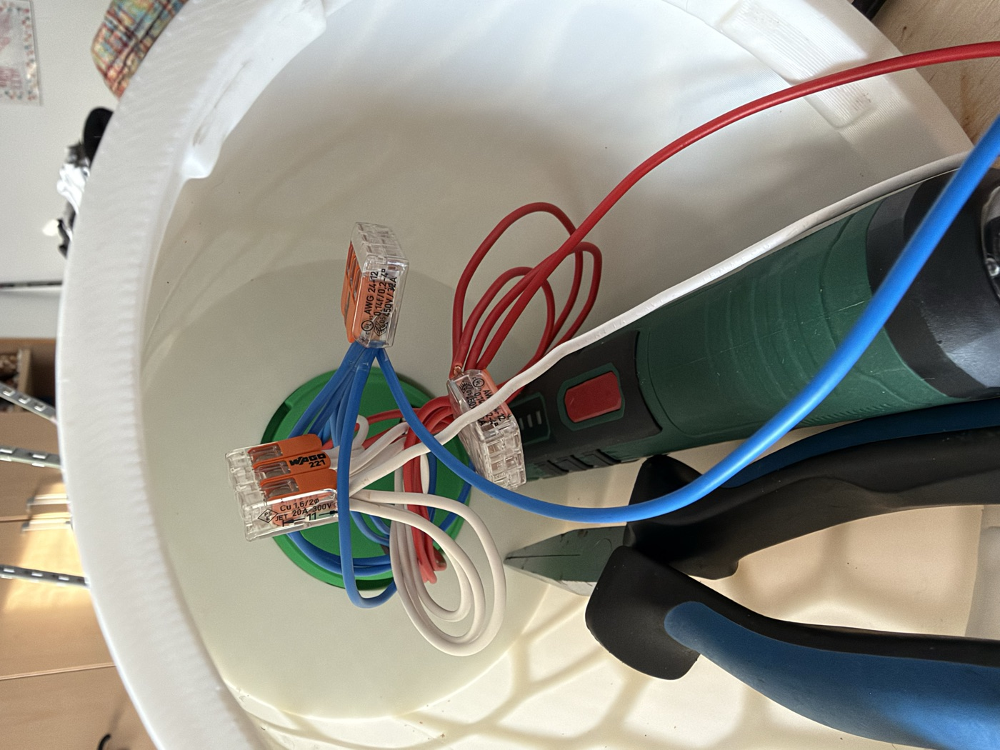 Wiring inside the vase: three Wago connectors join +5V, GND and data from the branches</td>
<td></td>
</tr>
</table>

### The electronics

<table align="center">
<tr>
<td align="center" valign="top">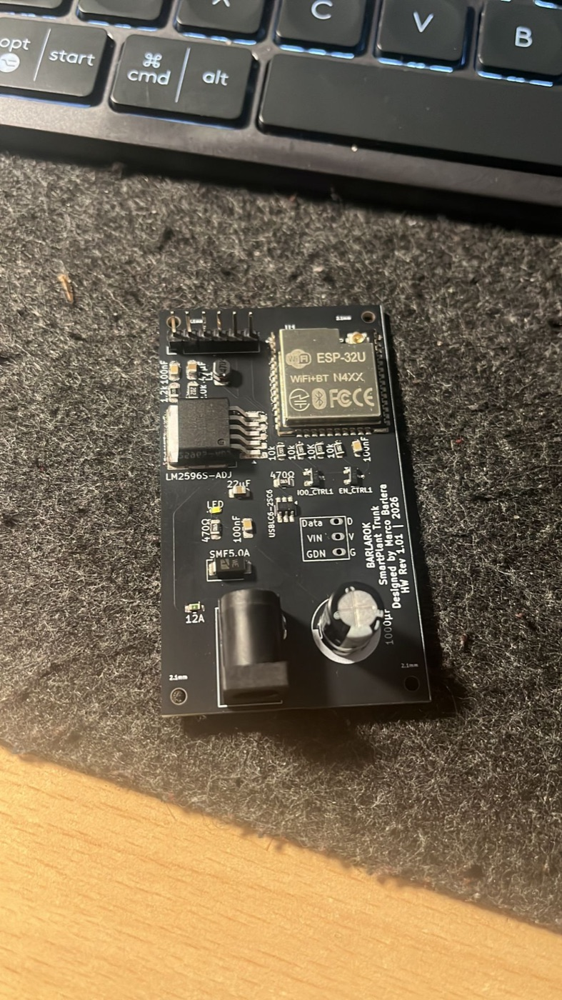 BaseChipOnly, fabricated board</td>
<td align="center" valign="top">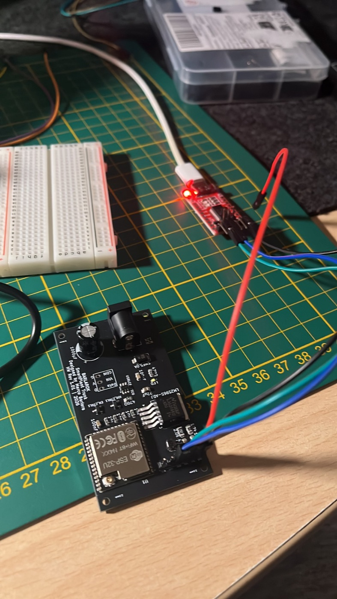 Bring-up on the bench: flashing over a USB-UART adapter</td>
<td align="center" valign="top">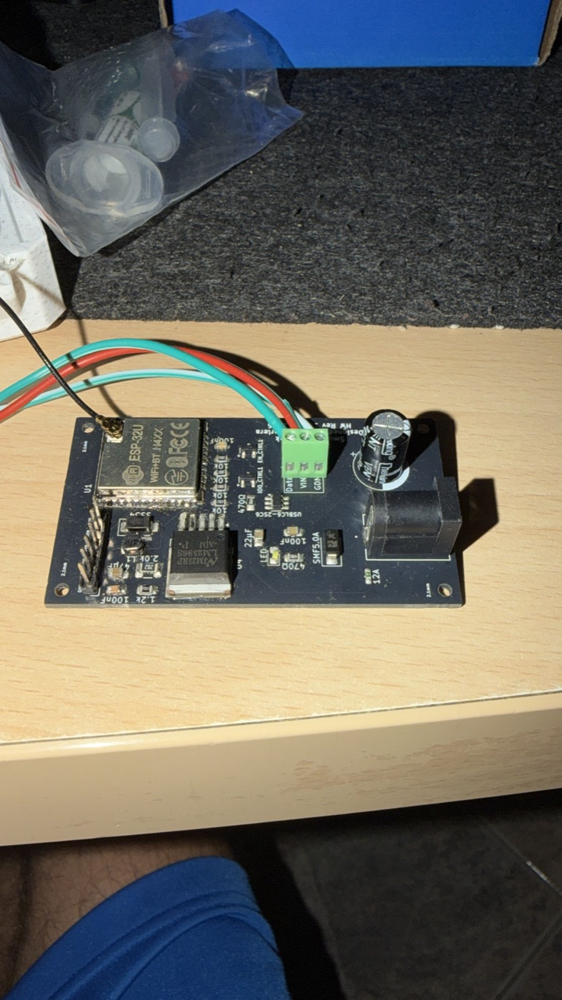 BaseChipOnly with the 3-pin screw terminal for the LED line (data, VIN, GND)</td>
</tr>
</table>

### Earlier versions

<table align="center">
<tr>
<td align="center" valign="top">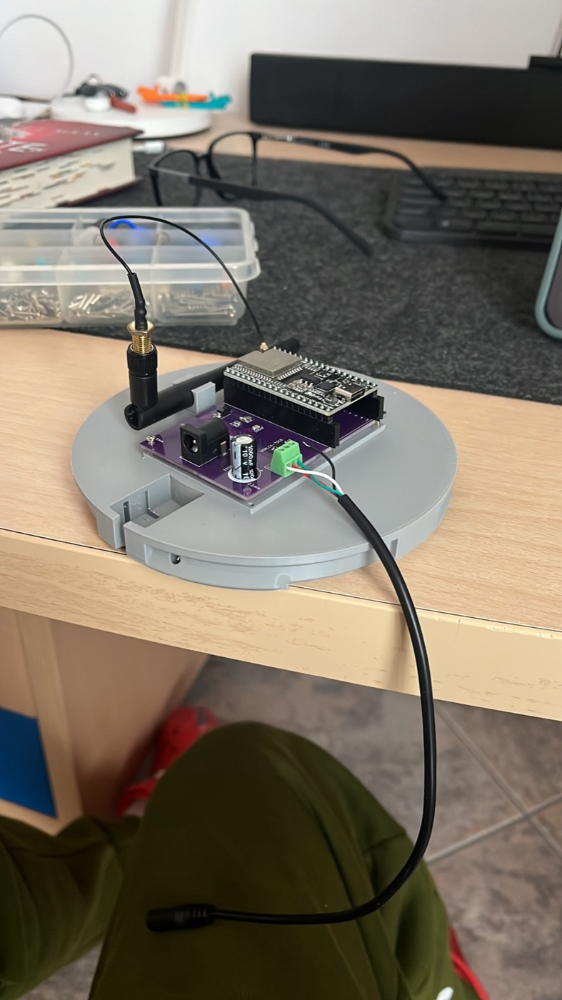 Earlier version: purple PCB with a plug-in ESP32 DevKit on pin headers (BaseDevKit), in the first grey 3D-printed base</td>
<td align="center" valign="top">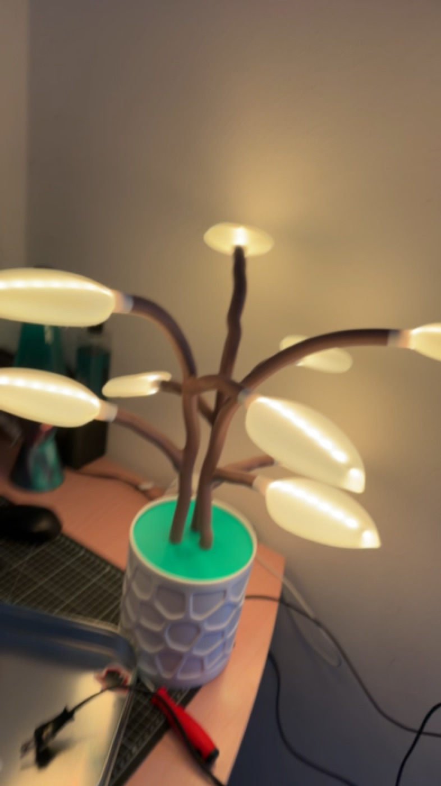 Earlier version (v2): the branches were joined together</td>
<td align="center" valign="top">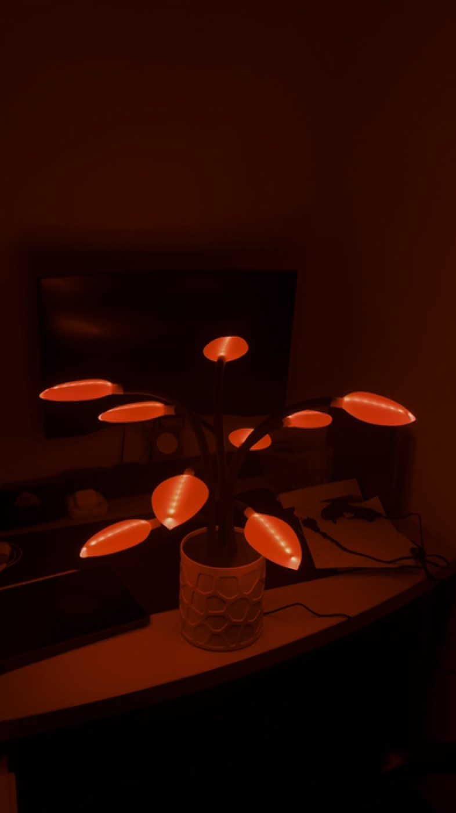 Earlier version (v0.1), first lit test</td>
</tr>
</table>

The two v2 and v0.1 photos are video frames, so their quality is lower.

---

[Back to the main README](../../README.md)
